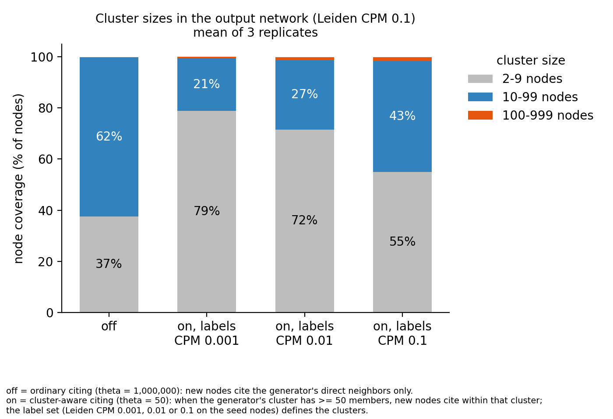

# ARCANA reference set (2026-11-07)

Nine simulations: ARCANA main with three different community-label files (Leiden CPM at resolutions 0.1, 0.01 and 0.001 of the seed
network), three replicates each. This folder holds the data behind the tables below, the inputs that are specific to this set, the
scripts that produced the numbers, and a description of every step, so the tables can be checked or regenerated.

**Weights.** These runs use the earlier default scoring weights (fit 0.70, the other three 0.10 each). The equal-weights set and a fit-weight sweep are in [weights_equal_2026-11-08](../weights_equal_2026-11-08/README.md), which is the reference set going forward; the two sets are not mixed.

**Retention.** On 2026-11-08 the raw networks (`nodelist.csv` and `edgelist.csv`) of these runs were deleted from the cluster. The tables, readout results, configs and scripts remain; see "Where the data live" below.

The runs are an abstract-model reference point for later sensitivity tests, not a calibration to a real network. Read patterns by
presence and direction, not by the absolute numbers.

## Terms

- **Cluster-aware citing:** a new node (agent) is modeled on a generator node. When the generator's cluster has at least `theta` nodes (here 50),
  the agent draws its distance-1 citations from that whole cluster, and a share set by `alpha` stays inside it.
- **Ordinary citing:** otherwise the agent cites from the generator's usual neighborhood in the citation network, with no special weight on its cluster.
  `theta=1000000` turns cluster-aware citing off. New nodes inherit their generator's cluster label either way. See `docs/USER_MANUAL.md`, section 5.1.

## Contents

| path | what it is |
|---|---|
| `data/reference_set_summaries.csv`, `data/control_set_summaries.csv` | one row per simulation (9 each): size, integrity check, hubs, tail, age profile, within-label citation fraction; cluster-aware citing on, and off (control) |
| `data/conductance_bands.csv`, `data/conductance_bands_control.csv` | Leiden-readout conductance by cluster-size band, per run (36 rows each): cluster-aware citing on, and off (control); `node_coverage` is a fraction (0 to 1) |
| `data/mechanism_check_population_output.txt`, `data/mechanism_check_agents_output.txt` | full output of the two checks that cluster-aware citing follows `theta` and `alpha` (see "Mechanism check") |
| `labels/seed_comm_cpm{0.1,0.01,0.001}_v3.csv` | the three community-label files (`node_id,cluster_id`, 26,686 seed nodes); `MD5SUMS.labels_and_scripts` has checksums |
| `config/` | the configuration of one run (resolution 0.01) and the run scripts; the other eight differ only in the labels line |
| `figures/band_coverage.png` | stacked-bar summary of the band table below |
| `scripts/` | `make_seed_labels_v3.py` (labels), `run_summaries.py` and `run_summaries_control.py` (simulation summaries), `conductance_analysis.py` (conductance by size band), `mechanism_check_population.py` and `plot_band_coverage.py` (figure), `mechanism_check_agents.py` (the two mechanism checks) |

## How the data were generated

### 1. Seed network and labels
- Seed set `mf_seed_v3`: 26,686 nodes and 273,490 citations (multifield seed; files `seed_nodelist_v3.csv`, `seed_edgelist_v3.csv`;
  MD5 `886ab386...` and `e0b8b92f...`). Recency table `multifield_reccount_v3.csv`, out-degree bag `multifield_out_degree_bag_v3.csv`
  (median out-degree 15), author-count bag `pubmed_2025_english_journals_v3.csv`. The inputs are described in `docs/inputs.tar.gz`
  (edgelist and tables are identical in content to the v2 seed).
- Labels: `scripts/make_seed_labels_v3.py` builds the undirected graph from `seed_edgelist_v3.csv` and runs `leidenalg` 0.12.0
  (`CPMVertexPartition`, igraph 1.0.0) with `seed=1` at resolution 0.1, 0.01 and 0.001 (the 0.1 file is the pre-existing one, which
  the script reproduces exactly). Cluster statistics:

| labels | clusters | singletons | clusters with ≥ 50 seed nodes | seed nodes in them | largest |
|---|---|---|---|---|---|
| 0.1 | 7,454 | 4,146 | 27 | 2,216 | 194 |
| 0.01 | 5,602 | 4,496 | 57 | 12,027 | 1,314 |
| 0.001 | 4,842 | 4,220 | 15 | 20,239 | 6,024 |

  Leiden is stochastic: an earlier unseeded 0.01 clustering (`simready_comm.csv`) agrees with the seeded 0.01 file at an adjusted
  Rand index of 0.66, and gave nearly identical simulation summaries (within-cluster 43.3% vs 43.2%, uncited 16.9% vs 17.0%).

### 2. Simulations
- Code: ARCANA `main` at commit b3e8ef0 (this repository). Build: GCC 13.3.0, OpenMPI 5.0.1, `-DCMAKE_BUILD_TYPE=Release`, on node-local
  storage; 32 OpenMP threads on one exclusive node, Illinois Campus Cluster `secondary` partition. Storage backend `ladybug`, database
  on node-local `/tmp`. `use_distributed=false`.
- Configuration (`config/config_cpm0.01.ini`; `docs/USER_MANUAL.md` explains each option): `growth_rate=0.1`, `num_cycles=40`
  (seed set grows to 1,208,027 nodes); `alpha=-1` (random per agent, uniform on [0, 1]); `theta=50`; `unbinned_age_sampling=true`;
  Dirichlet weights 0.10 / 0.70 / 0.10 / 0.10 for preferential attachment, fitness, author count and author reputation, concentration 50;
  `same_year_citations=0.12`; `fully_random_citations=0.05`; fitness 1 to 1000, permanent (peak duration 1000, no lag);
  `non_random_generator_probability=0`; INSTAR options at their defaults. The only line that differs between the three label sets is
  `community_assignment`.
- Replicates `r0`, `r1`, `r2` use identical configs; each run seeds its random generator from `std::random_device`, so the
  replicates differ only by chance. Jobs 12214453 to 12214461 (labels 0.1: 12214453-55, 0.01: 12214456-58, 0.001: 12214459-61).
  Run times were about 1:15 (0.1), 1:24 (0.01) and 3:26 (0.001) per job.
- Controls: nine further runs, `arcana/control_cpm{0.1,0.01,0.001}/r{0,1,2}`, jobs 12216239 to 12216254, identical to the baseline runs except `theta=1000000`
  (above the largest cluster, so cluster-aware citing never applies). Their multiscale readout was run in the same way.
- `scripts/run_summaries.py` reads each run's `nodelist.csv` and `edgelist.csv` and writes `data/reference_set_summaries.csv`. Checks:
  no duplicate edges, no self-citations, no citation from an older node to a newer one, and edge count equals total in-degree
  (column `integrity`). "Seed share of new citations" is the seed nodes' in-degree gain divided by all new citations. "Within-cluster"
  is the share of agent citations whose source and target carry the same `cluster_id` (each run's own labels).

### 3. Multiscale readout
The `SASCA-ReSA-INSTAR-multiscale` pipeline (commit 4c856a6, `slurm/run_pipeline.sh`) ran micro, IKC, Leiden and macro stages and a merge
job for each run. Leiden stage: CPM on the undirected citation graph of the whole output network at **resolution 0.1**, `seed=1`
(`mesoscale_readout.py leiden`), giving `meso/leiden_clusters.csv` with each cluster's size, cut, volume and conductance. The readout
resolution is 0.1 for all nine runs, whichever labels were used as input. CPM resolution is a minimum internal edge density, so 0.1
is the strictest of the three scales.

### 4. Conductance by size band (`scripts/conductance_analysis.py`)
Conductance of a cluster = cut / min(volume, 2E − volume), with cut the number of edges leaving the cluster, volume the sum of its
members' degrees, and E the number of edges; 0 means no edges leave and 1 means fully mixed with the rest (the definition used in
`mesoscale_readout.py`).
- **Bands.** Leiden-readout clusters are grouped by size into half-open bands [2, 10), [10, 100), [100, 1000) and [1000, ∞)
  (a cluster of 10 nodes is in the second band). Per run and band the table gives the number of clusters, nodes, node coverage,
  median and quartiles of conductance, minimum, and the number below 0.5.

Outcomes are read from this post-simulation clustering, which uses no labels. It does not depend on which clusters qualified for
cluster-aware citing or when, so the comparison between runs does not rely on the bookkeeping of inherited labels.

## Results

### Simulations (mean of three replicates; spread across replicates is small)

| labels | citing | within-label | uncited | seed share of new citations | agent top-0.1% in-degree median | agents > 50k in-degree | agent max | citations aged 1–4 y |
|---|---|---|---|---|---|---|---|---|
| Leiden 0.1 | cluster-aware | 40.3% | 15.1% | 4.54% | 2,320 | 2.0 | 55.6k | 34.4% |
| Leiden 0.1 | off (control) | 13.4% | 14.4% | 5.03% | 2,982 | 4.7 | 73.8k | 30.8% |
| Leiden 0.01 | cluster-aware | 43.2% | 17.0% | 4.67% | 2,914 | 2.0 | 57.9k | 34.5% |
| Leiden 0.01 | off (control) | 15.5% | 14.4% | 5.03% | 3,005 | 2.3 | 69.6k | 30.8% |
| Leiden 0.001 | cluster-aware | 44.1% | 18.5% | 4.78% | 3,778 | 7.3 | 68.1k | 34.8% |
| Leiden 0.001 | off (control) | 32.3% | 14.4% | 5.03% | 3,094 | 5.0 | 85.3k | 30.8% |

"Within-label" is the share of agent citations whose source and target carry the same label, measured against each run's own labels. With
cluster-aware citing off, uncited share, seed share and age profile are identical across the three label sets, as they should be when the
labels play no part in how agents cite.

### Leiden readout (resolution 0.1) by cluster-size band (mean of three replicates)

*Node coverage by cluster-size band (Leiden CPM 0.1 on the output network), mean of three replicates. **Off** is ordinary citing (`theta=1000000`): a new node cites the direct neighbors of its generator node. **On** is cluster-aware citing (`theta=50`): when the generator's cluster has at least 50 members, the new node cites within that cluster. The label set that defines the clusters is the Leiden CPM resolution (0.001, 0.01 or 0.1) applied to the seed nodes; with citing off, labels play no part, so the nine control runs are pooled into one bar. `scripts/plot_band_coverage.py` draws the figure from `data/conductance_bands_control.csv`.*

**Node coverage** in a band table is the percentage of all nodes in the network that sit in a Leiden cluster whose size is in that band: the nodes in the band's clusters divided by all nodes (about 1.21 million). It is not the share of clusters. Coverage across bands sums to about 100%, apart from nodes left alone in a one-node cluster.

| input labels | band | on: clusters | on: node coverage | on: median conductance | off: clusters | off: node coverage | off: median conductance | clusters < 0.5 (on / off, all replicates) |
|---|---|---|---|---|---|---|---|---|
| 0.1 | 2–9 | 132,909 | 55% | 0.919 | 77,957 | 37.5% | 0.889 | 0 / 0 |
| 0.1 | 10–99 | 20,269 | 43% | 0.847 | 50,290 | 62.4% | 0.820 | 5 / 0 |
| 0.1 | 100–999 | 162 | 1.4% | **0.716** | 5 | 0.1% | 0.845 | 0 / 0 |
| 0.01 | 2–9 | 180,363 | 72% | 0.926 | 77,847 | 37.4% | 0.889 | 0 / 0 |
| 0.01 | 10–99 | 14,932 | 27% | 0.859 | 50,417 | 62.4% | 0.820 | 0 / 0 |
| 0.01 | 100–999 | 134 | 1.3% | 0.835 | 5 | 0.1% | 0.835 | 0 / 0 |
| 0.001 | 2–9 | 205,240 | 79% | 0.929 | 77,844 | 37.5% | 0.889 | 0 / 0 |
| 0.001 | 10–99 | 13,312 | 21% | 0.869 | 50,283 | 62.4% | 0.820 | 0 / 0 |
| 0.001 | 100–999 | 38 | 0.4% | 0.906 | 5 | 0.1% | 0.841 | 0 / 0 |

No run, on or off, has a cluster of 1000 or more nodes. The replicate-to-replicate sd of each median is 0.001 or less (0.027 for the 38
clusters at 0.001; 0.003 to 0.009 for the five control clusters).

## Reading the results, and limits
- **Cluster-aware citing does what it is meant to** (see the mechanism check below): with it on, 40 to 44% of agent citations stay within a label,
  against 13 to 32% with it off.
- **At the 0.1 readout it mostly moves nodes out of dense small clusters.** With ordinary citing, 62% of nodes sit in clusters of 10 to 99
  nodes (median conductance 0.820) and 37% in clusters of 2 to 9. With cluster-aware citing the 10 to 99 share falls to 43%, 27% and 21% for the
  0.1, 0.01 and 0.001 labels, and its median conductance is worse (0.847, 0.859, 0.869). A plausible reading, not tested here: agents that cite
  across a whole cluster rather than the generator's local neighborhood dilute the dense local structure CPM at 0.1 detects, and build
  coarser communities that this readout cannot report.
- **The one gain is with the finest labels.** Labels at 0.1 produce 162 clusters of 100 to 999 nodes at median conductance 0.716, against 5 clusters at 0.845
  without cluster-aware citing. Coarser labels do not: 0.01 gives 134 clusters at 0.835 (the control's 5 at 0.835) and 0.001 gives 38 at 0.906 (control 0.841).
- **Among the cluster-aware runs, finer labels read better** (more nodes in 10 to 99 clusters, lower conductance in the 100 to 999 band),
  while coarser labels give more within-label citing, a heavier agent tail and more uncited nodes. Relative to ordinary citing, only the
  0.1 labels improve any band.
- The readout resolution is 0.1 on purpose. CPM at 0.1 reports a group as a cluster only if it is dense inside, so it can underestimate
  community structure (communities of thousands of nodes are too sparse to qualify, which is why no cluster reaches 1000 nodes) but it
  does not overestimate it. Conductance of small clusters still has a size floor: a small tidy clique cannot score low in a graph with
  this mean degree.
- Limits: one seed set; three replicates per condition; one seeded clustering per resolution; one readout resolution. The
  readout at 0.1 does not see communities of thousands of nodes, so a readout at a coarser resolution could show a different balance.
- The raw networks (`edgelist.csv`, `nodelist.csv`, about 450 MB per run) are kept on the cluster, not in this repository (see
  "Where the data live" below).

## Mechanism check: does ARCANA apply `theta` and `alpha` as documented?

Two checks use only `nodelist.csv` and `edgelist.csv`. They compare the nine baseline runs with the control runs, which are identical
except for `theta=1000000` (so cluster-aware citing never applies). Generators are drawn uniformly (`non_random_generator_probability=0`),
so cluster growth does not depend on how agents cite, and the pairs differ only in citing behavior. These checks use the labels on
purpose: they test the mechanism, not the outcome.

**Rule being tested** (`src/abm.cpp`, `src/neighborhood_search.cpp`). A new node reserves one edge for its generator, possibly one for a
same-year citation, and `floor(0.05 × out-degree)` edges for fully random citations. The remaining quota Q is split by the agent's own
`alpha`: `n1 = floor(alpha × Q)` go to distance 1, the rest to distance 2. If the generator's cluster has at least `theta` members (seeds and
agents together, published before the agent's year) and `alpha > 0`, distance 1 is the whole cluster (excluding the generator and nodes of
the current year) and distance 2 is restricted to nodes outside the cluster. Otherwise distance 1 is the generator's direct neighbors.

### Check 1, population level (`scripts/mechanism_check_population.py`; sample: replicate r0 of each label set, 6 networks)
For every agent, the size of its cluster at birth is the number of cluster members with an earlier year. The within-cluster citation share
is pooled by size bin (edges at theta), and compared with the control.

| labels | P1: jump in the share at size 50 (on), pass if ≥ 10 points | P2: same jump, mechanism off, pass if < 2 | P3: gap on − off below 50 (pass if ≤ 1.5) / from 50 to 120 (pass if ≥ 10) | P4: slope per unit alpha, qualified agents on vs off (pass if gap ≥ 0.3); unqualified on vs off (pass if within 0.1) |
|---|---|---|---|---|
| 0.1 | 34.4 | 0.1 | +0.7 to +0.9 / +35 | 0.92 vs 0.15; 0.13 vs 0.12 |
| 0.01 | 33.8 | 0.3 | +1.3 to +1.5 / +35 | 0.92 vs 0.16; 0.14 vs 0.12 |
| 0.001 | 34.3 | 0.2 | +0.7 to +1.0 / +35 | 0.92 vs 0.17; 0.13 vs 0.12 |

All four predictions pass in all three label sets. Below 50 the on and off curves nearly coincide; at 50 the on curve jumps by about 34
points and stays near 48.5%, while the off curve stays at 13–14%. Within-label citing rises with the agent's own alpha only once the
cluster has qualified. The gap below 50 is slightly positive (0.5 to 1.5 points): a likely spillover, because earlier cluster-aware agents
make later generators' neighborhoods a little more intra-cluster (an interpretation, not tested). The thresholds are the author's, set
before the run.

### Check 2, agent level (`scripts/mechanism_check_agents.py`; random sample of 2,000 qualified and 2,000 unqualified agents, replicate r0)
Per agent, the quota `n1 = floor(alpha × Q)` is computed from the nodelist (out-degree, `fully_random_citations`, the agent's `alpha`, and one
same-year edge if the edgelist shows one). Observed: the number of its citations that land in its own cluster (earlier nodes other than the
generator), and the number that land in the generator's direct neighborhood (references of the generator plus earlier nodes citing it,
a superset of what the code uses). Cartel agents, agents with `alpha = 0` and out-degree below 5 are excluded.

| sample | citations into the cluster vs n1 | citations into the generator's neighborhood vs n1 |
|---|---|---|
| qualified, labels 0.01 | n1 ≤ k ≤ n1 + random edges for **100%**; k − n1 quartiles [0, 0, 0]; mean k 8.37 = mean n1 8.37 | 0.32 (n1 4.38): not drawn from the neighborhood |
| qualified, labels 0.1 | **100%**; mean k 8.53 vs n1 8.55 | 0.50 (n1 4.64) |
| unqualified, labels 0.01 / 0.1 | only 10.0% / 10.3% reach n1 (mean k 1.46 / 1.45 against n1 8.31 / 8.46): ordinary in-cluster rate | **100%** at least n1; mean 3.69 = 3.69 and 3.93 = 3.93 |
| control (`theta=1000000`), size ≥ 50, labels 0.01 | only 12.8% reach n1 (mean k 2.07 against 8.40) | 100% at least n1 |
| all | generator cited by 100% | |

A qualified agent puts exactly its distance-1 quota into its cluster and none of it into the generator's neighborhood; an unqualified
agent does the reverse; and with the mechanism off, the same agents miss the in-cluster quota, so the check does detect a failure. Limits:
a sample of one replicate per label set; the neighborhood is a superset, which can weaken but not strengthen the lower-bound check.

## Where the data live

**These paths are on the Illinois Campus Cluster project storage. They may stop being valid after some time: the data-retention policy will apply. On 2026-11-08 the raw networks (`nodelist.csv` and `edgelist.csv`) of every run listed here were deleted; the run folders (config, scripts, logs) and the readout results remain. A run takes about two minutes, so the networks can be regenerated, but the random seed is not logged: a regenerated network is statistically equivalent, not identical. The repository (tables, labels, configs, scripts and this description) is the durable record.**

| what | path |
|---|---|
| Raw networks and logs of the nine runs | `/projects/illinois/eng/cs/chackoge/illinoiscomputes/arcana/baseline_cpm{0.1,0.01,0.001}/r{0,1,2}/output/` (`edgelist.csv`, `nodelist.csv`, `log.txt`, `abm.err`) |
| Run folders (config, scripts, Slurm log) | `/projects/illinois/eng/cs/chackoge/illinoiscomputes/arcana/baseline_cpm{0.1,0.01,0.001}/r{0,1,2}/` |
| Multiscale readout per run (`micro/`, `meso/`, `macro/`, `summary_all.csv`) | `/projects/illinois/eng/cs/chackoge/illinoiscomputes/chackoge/deltacon_testing/multiscale_results/arcana_reference/cpm{0.1,0.01,0.001}/r{0,1,2}/` |
| The three tables as written by the scripts | `/projects/illinois/eng/cs/chackoge/illinoiscomputes/arcana/reference_set_summaries.csv` and `.../chackoge/deltacon_testing/multiscale_results/arcana_reference/{conductance_bands,label_cluster_conductance}.csv` |
| Label files and their scripts and checksums | `/projects/illinois/eng/cs/chackoge/mf_seed_v3/leiden_cpm/` (read-only) |
| Seed set `mf_seed_v3` | `/projects/illinois/eng/cs/chackoge/mf_seed_v3/` |
| ARCANA source used (as an archive) | `/projects/illinois/eng/cs/chackoge/illinoiscomputes/arcana/archive_2026-11-07/arcana_code.tar.gz` (this repository at commit b3e8ef0 is the same code) |
| Multiscale pipeline | GitHub `illinois-or-research-analytics/SASCA-ReSA-INSTAR-multiscale` at commit 4c856a6; cluster clone `.../chackoge/deltacon_testing/multiscale_repo` |
| Pipeline settings | `/projects/illinois/eng/cs/chackoge/illinoiscomputes/arcana/multiscale_ref_cpm{0.1,0.01,0.001}.env` |

The scripts in `scripts/` contain these absolute paths at the top; edit them if the data move.

## Regenerating
1. Labels: `python scripts/make_seed_labels_v3.py OUTDIR 0.1 0.01 0.001` (paths inside the script point to the cluster seed folder).
2. Simulations: for each label file, set `community_assignment` in a copy of `config/config_cpm0.01.ini`, build ARCANA at b3e8ef0, and run
   `abm --config config.ini --db-path <node-local dir>` three times.
3. Readout: the multiscale pipeline at commit 4c856a6 with `LEIDEN_RES=0.1`.
4. Tables: `scripts/run_summaries.py` and `scripts/conductance_analysis.py` (cluster paths at the top of each file).
